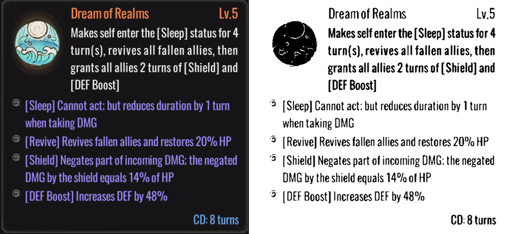

# Otimizei meu OCR até 100% de acerto. Numa imagem só.

*Estudo de caso do [RealTime Screen Translator](https://github.com/Daniel-S-Carneiro/RealTime-Screen-Translator)*
*Daniel S. Carneiro · rascunho de novembro de 2026*

> **Resumo.** Durante um mês, rodei milhares de combinações de filtros de imagem e
> parâmetros de OCR para deixar meu tradutor de jogos mais preciso e mais rápido.
> Usei força bruta, busca binária, quartis e até um modelo de linguagem (BERT) para
> corrigir o texto. Cheguei a 100% de acerto. Quando testei num print real de jogo,
> o pipeline "campeão" perdeu para a imagem sem tratamento nenhum, que foi mais
> precisa e três vezes mais rápida. Depois, juntei 90 prints de 11 jogos e passei a
> mudar o app só com o que melhorava a maioria deles. As regras levaram o acerto de
> 87,7% para 89,8% das letras. Trocar o EasyOCR pelo RapidOCR, que roda os modelos do
> PaddleOCR, levou a 92,2% das letras e 88% das palavras, em cerca de 1 s por print.
> Ler fichas e grades coluna por coluna levou a 95,1% das letras e 91,1% das palavras,
> e separar os itens de menu lado a lado e as linhas de aviso e título levou o app a
> achar 89% das quebras de linha.
> Este texto conta o que fiz, onde errei e o que mudou.

---

## 1. O projeto

O RealTime Screen Translator é um tradutor de tela para jogos. Uma janela
transparente fica por cima do jogo. Ao clicar em **Traduzir Área**, o programa:

1. tira um print da região embaixo da janela;
2. trata a imagem;
3. lê o texto com OCR (reconhecimento óptico de caracteres);
4. limpa o texto lido;
5. traduz e mostra o resultado na própria janela.

**Tecnologias:** Python, PySide6 (interface), mss (captura de tela), OpenCV e
Pillow (imagem) e RapidOCR, que roda os modelos do PaddleOCR na CPU (OCR). Até a seção 7,
o OCR era o EasyOCR, rodando na GPU. A tradução sai do Google Tradutor, das
APIs oficiais da Azure, do DeepL e do Google Cloud, ou do Argos Translate, que roda
offline. Todos os testes rodaram num notebook com uma GeForce MX350.

A etapa difícil é o OCR. Texto de jogo é o pior caso: fontes estilizadas, cores
fortes, fundos com textura, letras pequenas e números que não podem sair errados
(dano, HP, porcentagens).

## 2. A pergunta

> Qual tratamento de imagem e qual configuração do EasyOCR dão o **maior acerto**
> no **menor tempo**?

## 3. Como medi

- **Imagem de teste:** `teste.png`, um texto de missão de 615 caracteres em fonte
  monoespaçada, letras claras sobre fundo escuro (1249×363 px).
- **Gabarito:** `teste.txt`, com o texto exato da imagem.
- **Métrica:** similaridade de Levenshtein entre o texto lido e o gabarito, em
  minúsculas. 100% significa texto idêntico.
- **Pipeline de imagem** em 5 etapas, cada uma com versão OpenCV e versão Pillow:

| Etapa | O que faz |
|---|---|
| Aumentar | Amplia a imagem em 2x |
| Ruído inicial | Filtro de mediana para tirar pontos soltos |
| Cor | Fica só com um canal (o verde) |
| Binarizar | Deixa tudo preto ou branco (Otsu ou limiar adaptativo) |
| Ruído final | Abertura morfológica para limpar o que sobrou |

Também tomei cuidados de medição que valeram a pena: uma rodada de aquecimento
antes de cronometrar (a primeira chamada na GPU é sempre mais lenta), média de
várias execuções e tempo medido etapa por etapa.

## 4. Os experimentos

Entre 13 de julho e 9 de agosto de 2026, escrevi 18 scripts de laboratório.

### 4.1 Força bruta

Se a ordem das etapas importa, e cada etapa pode usar OpenCV ou Pillow, existem
**5! ordens × 2⁵ bibliotecas = 3.840 combinações**. Rodei todas.

Somando a força bruta e o ajuste fino de parâmetros que veio depois, os relatórios
registram quase **10 mil combinações**.

O achado mais sólido dessa fase: **binarizar com Otsu é muito melhor que limiar
adaptativo**. Na média, Otsu acertou 97,9%, contra 58,3% e 52,0% dos dois métodos
adaptativos.

### 4.2 Gastando menos execuções: busca binária e separatrizes

Força bruta custa caro, então passei a buscar os parâmetros de forma mais esperta.

**Busca binária no `beamWidth`.** O decoder *beam search* do EasyOCR testa várias
hipóteses de leitura ao mesmo tempo. Quanto mais hipóteses, mais lento. Defini uma
meta de acerto (99,59%) e procurei o **menor** `beamWidth` entre 1 e 10 que
ainda batesse a meta:

```python
while limite_inferior <= limite_superior:
    meio = (limite_inferior + limite_superior) // 2
    acerto = medir(beamWidth=meio)
    if acerto >= META:
        melhor = meio                 # passou: tenta um valor menor
        limite_superior = meio - 1
    else:
        limite_inferior = meio + 1    # caiu: precisa de mais hipóteses
```

Em vez de 10 testes, foram 3 (larguras 5, 2 e 3). O resultado foi `beamWidth = 3`.

**Separatrizes (quartis) no contraste.** Para o `adjust_contrast`, testei primeiro
os quartis 0,25, 0,50 e 0,75 para achar a região promissora. Depois fiz uma busca
por bisseção no `contrast_ths`.

### 4.3 Ajudando o OCR com regex e IA

O OCR erra pontuação e letras soltas, então criei uma camada de pós-processamento:

- **Regex:** cola pontuação solta (`"HP ."` vira `"HP."`), remove resíduos
  (`"DMGI"` vira `"DMG"`) e insere o ponto final que o OCR "comeu" entre uma palavra
  minúscula e uma maiúscula (`"shadows If"` vira `"shadows. If"`).
- **SpellChecker + BERT:** o corretor ortográfico acha as palavras desconhecidas.
  O BERT, um modelo de linguagem, sugere a palavra que faz sentido naquele contexto,
  e fico com a sugestão mais parecida com o erro.

Num texto com erros reais de OCR (`"Good uck"`, `"recovery ."`), a correção
chegou a **100%**.

### 4.4 Onde o tempo realmente vai

Cronometrando cada etapa do pipeline campeão:

| Etapa | Tempo | % do total |
|---|---|---|
| 5 filtros de imagem, somados | 0,018 s | 0,14% |
| **OCR (EasyOCR, beam search)** | **12,67 s** | **95,89%** |
| Regex + SpellChecker | 0,001 s | 0,00% |
| BERT | 0,52 s | 3,96% |

E comparando decoders, todos com 100% de acerto em `teste.png`:

| Decoder | Tempo do OCR |
|---|---|
| **Greedy** | **6,74 s** |
| Beam search, largura 3 | 8,91 s |
| Beam search, largura 5 | 10,60 s |
| Beam search, largura 10 | 13,12 s |

### 4.5 E a tradução?

Comparei a tradução do Google com uma tradução de referência usando similaridade
semântica (o modelo MiniLM, que mede se duas frases dizem a mesma coisa). O resultado
foi **97,8%**. A similaridade letra por letra dava só 93%, porque traduções
corretas podem usar palavras diferentes. Conclusão: o tradutor não era o gargalo
de qualidade.

## 5. A virada: o primeiro print real

Alguns sinais já estavam nos relatórios, e eu não tinha dado atenção a eles.

**Sinal 1: empate demais.** No ajuste fino, **160 pipelines diferentes empataram
com o mesmo texto, caractere por caractere**. A partir daí, escolher o "campeão"
entre eles era sorteio: o teste já não conseguia diferenciar uma opção da outra.

**Sinal 2: metade dos dados era erro.** O passo `Binarizar` do Pillow devolve uma
imagem no modo `"1"` (booleana), que quebra as funções do OpenCV seguintes.
**1.920 das 3.840 linhas** da força bruta eram `ERRO`. Na prática, o Pillow nunca
foi avaliado.

**Sinal 3: otimizei a parte que quase não pesa.** Semanas foram para a ordem dos
filtros, que somam 0,14% do tempo. Testei três tipos de interpolação no aumento,
mas a escala ficou sempre em 2x, e isso deixa a imagem com 4x mais pixels para o
OCR processar.

Então peguei um print real de um jogo, uma descrição de habilidade com texto laranja,
branco e roxo sobre um fundo escuro com textura, e rodei o pipeline que estava em
produção:



*À esquerda, o print original. À direita, o resultado do pipeline campeão.*

Para nós, a imagem da direita parece mais limpa. Para o OCR, não:

| Configuração | Acerto | Tempo do OCR |
|---|---|---|
| Pipeline campeão dos labs (o de produção na época) | 97,1% | 3,7 s |
| **Imagem sem tratamento, decoder greedy** | **99,8%** | **1,1 s** |

O pipeline campeão leu `"14% of HP"` como **`"74% of HP"`**. Em outra imagem, o
aumento combinado com a limpeza morfológica juntou o "rn" de "turn" e produziu
**"tum"**. Os marcadores de lista (as espirais) viraram caracteres `5` soltos no
meio do texto.

O pós-processamento também piorou o texto real:

| Entrada | Saída |
|---|---|
| Press Enter to continue | Press**.** Enter to continue |
| New Game Load Game | New**.** Game Load**.** Game |
| Find Aerith near the Sector 5 Church | Find**. Earth** near the Sector 5 Church |
| Talk to Geralt in Novigrad | Talk to **Gerald** in Novigrad |
| Lv.5 | **La**.5 |

A regra do ponto final nasceu de `"shadows If"`, uma frase do meu texto de teste.
Em menus de jogo, porém, palavras com inicial maiúscula lado a lado são a regra. E o
BERT trata nomes de personagens como erros de digitação.

Por fim, a produção nem usava o que os labs tinham descoberto. Rodava beam search
com `beamWidth=1`, abaixo do mínimo de 3 que a minha própria busca binária havia
encontrado. Com largura 1, o decoder **engole letras duplas**: saíram "spoted",
"imediately", "God luck" e "falen alies". O BERT disfarçava parte disso no
`teste.png`, ao custo de mais de 1 segundo por tradução.

### O diagnóstico: *overfitting*

Em aprendizado de máquina, *overfitting* acontece quando um modelo decora os dados
de treino e falha em dados novos. Foi exatamente o que fiz, só que à mão. Eu tinha
**uma imagem**, e ela servia ao mesmo tempo de treino e de prova. Cada filtro, cada
parâmetro e cada regra de regex foram ajustados para ela. O resultado ficou perfeito
ali e pior em todo o resto.

As técnicas de busca não tinham culpa: busca binária e quartis funcionam quando há
uma curva a percorrer. Só que, com uma imagem só, a curva era praticamente plana,
quase tudo entre 99,6% e 100%. As buscas ficaram mais baratas, mas não havia nada
para encontrar. **O problema não era como eu procurava, era onde eu procurava.**

## 6. A correção de rumo

**Organização.** Os 18 scripts de laboratório e os relatórios foram arquivados. No lugar deles
entrou um único [benchmark](../benchmark/README.md), que **importa o código de
produção** em vez de copiá-lo. O app e o benchmark chamam a mesma função
(`pipeline_ocr.reconhecer_texto`), então o que é medido é exatamente o que roda.

**Métrica nova.** Troquei a similaridade pela **CER** (taxa de erro de caracteres:
quantas letras precisariam ser corrigidas, dividido pelo tamanho do texto) e pela
**WER** (o mesmo, contando palavras). Ambas são calculadas por imagem, para eu ver
onde o pipeline erra, e não só a média.

**Dataset real.** O próprio app ganhou um modo de coleta: cada captura é salva junto
com o texto lido, que serve de rascunho para o gabarito. Corrijo o rascunho olhando
a imagem e o par entra no benchmark.

**Mudanças na produção:**

| Antes | Depois | Por quê |
|---|---|---|
| Beam search, largura 1 | Greedy | Mais rápido e não engole letras duplas |
| Imagem binarizada e ampliada 2x | Só tons de cinza | Menos erro e de 2 a 4x mais rápido nas imagens do benchmark |
| Caixas de texto na ordem do EasyOCR | Ordenadas por linha | Trechos inclinados iam parar no fim do texto |
| Regex agressivo + BERT sempre ligados | Desligados por padrão, opcionais | Pioravam texto real e nomes próprios |
| BERT carregado ao abrir o app | Carregado só se for usado, e só em inglês | Abertura mais rápida; o modelo só conhece inglês |
| OCR na thread da interface | OCR e tradução em segundo plano | A janela congelava de 3 a 5 s a cada tradução |

**Primeiro resultado do benchmark** (3 imagens; CER menor é melhor):

| Configuração | Erro médio (CER) | Tempo médio |
|---|---|---|
| **Produção nova** (cinza + greedy) | **0,78%** | **2,9 s** |
| Imagem colorida sem tratamento | 0,97% | 2,9 s |
| Pipeline binarizado dos labs | 1,41% | 7,0 s |
| Regex agressivo + BERT | 0,89% | 3,6 s |

Três imagens ainda é pouco. O próximo passo é chegar a 15–30 prints de jogos
variados.

## 7. Resultados no dataset real

Juntei **90 prints com gabarito**: 87 de 11 jogos e os 3 exemplos públicos do
repositório. Os jogos são o Immortal Clan, um RPG de cultivo para celular que também tem
versão para PC na Steam e foi o primeiro testado, e mais dez, escolhidos para variar o
máximo possível:

| Jogo | O que ele testa |
|---|---|
| Immortal Clan | muito texto: descrições de técnicas, loja, mapa e missões |
| Undertale | fonte em pixel |
| Doki Doki Literature Club | legenda com glitch |
| Danganronpa | título inclinado |
| Persona 4 Golden | menus coloridos |
| Fallout: New Vegas | painéis lado a lado |
| Morrowind | fonte medieval pequena |
| Mass Effect | legendas centralizadas |
| Night in the Woods | cartazes, letreiros e uma fonte gótica de pixel |
| EVE Online | menus de letra miúda |
| Caves of Qud | fonte monoespaçada e tabelas |

**Como montei o dataset.** Joguei cada jogo com o app no modo de coleta: cada captura
salva o print e o texto que o OCR leu. Depois corrigi esse rascunho olhando a imagem, e
ele virou o gabarito. Algumas regras deixaram a comparação justa:
- **ordem de leitura de uma pessoa:** numa tela com painéis, um painel de cada vez;
- **uma linha por parágrafo ou item:** título, opção de menu e fala ficam em linhas
  próprias, e a frase que só continuou embaixo fica numa linha só;
- **texto cortado:** o que a borda do print cortou fica fora; o que o próprio jogo
  cortou ("Manufacture & Researc") entra como aparece;
- **desenhos ficam fora:** ícones, botões do controle e o cursor de seleção. Marcadores
  escritos, como o "*" do Undertale, entram;
- **letra de música e texto completo de terceiros** (um poema, uma carta inteira) ficam
  sem gabarito, porque o gabarito seria uma cópia da obra.

O resultado de cada print está em dois anexos: [com o RapidOCR](resultados-benchmark.md),
o motor atual, e [com o EasyOCR](resultados-benchmark-easyocr.md), o motor até 16/11/2026.

Além de CER e WER, o benchmark passou a medir as **quebras de linha**:
- **achadas:** das quebras do gabarito, quantas o app pôs;
- **certas:** das que o app pôs, quantas estavam no gabarito.

Isso importa porque o texto vai para o tradutor parágrafo por parágrafo. Uma frase
cortada no meio sai mal traduzida, mesmo com todas as letras certas.

**Antes de comparar, uma surpresa: o OCR varia entre execuções.** Rodei o mesmo
benchmark duas vezes, e 13 dos 52 prints de letra pequena mudaram de resultado (um foi
de 11% para 7% de erro). Para comparar ideias com justiça, rodei o OCR uma vez em cada
versão da imagem e guardei as caixas lidas. Depois testei todas as regras sobre
exatamente a mesma leitura. De quebra, cada teste passou a levar segundos, em vez de
minutos.

### Preparar a imagem: nada ganhou do cinza

| Versão da imagem | CER | WER | Tempo | Prints melhores / piores |
|---|---|---|---|---|
| **Tons de cinza (atual)** | **12,27%** | **26,15%** | **2,8 s** | — |
| Inverter as cores quando o fundo é escuro | 12,42% | 29,27% | 2,8 s | 21 / 28 |
| Inverter só com muito fundo preto | 12,49% | 26,93% | 2,8 s | 16 / 24 |
| Desfoque leve, para suavizar fonte em pixel | 17,25% | 39,20% | 3,0 s | 13 / 52 |
| Ampliar 2x e desfocar | 13,32% | 28,49% | 10,1 s | 25 / 38 |
| Reduzir e ampliar de volta | 22,99% | 46,80% | 3,1 s | 11 / 60 |

**Inverter as cores** parecia óbvio, já que 67 a 80 dos 90 prints têm fundo escuro.
Mas o EasyOCR não ficou melhor com letra escura em fundo claro: ganhou em alguns jogos e
perdeu em outros.

**Suavizar as letras** ajudou a fonte em pixel grande, como a do minijogo do Night in
the Woods, e destruiu a letra pequena do EVE e do Morrowind. Aplicar a suavização só nos
prints em pixel art também não compensaria: o Undertale, que é todo em pixel, melhorou
num print e piorou em dois.

### Ler o texto: o que entrou na produção

| Mudança (acumulada) | CER | WER | Quebras achadas | Quebras certas |
|---|---|---|---|---|
| Produção anterior | 12,27% | 26,15% | 69% | 78% |
| + corrigir letras que a fonte confunde | 11,73% | 23,74% | 69% | 78% |
| + descartar desenhos lidos como texto e endireitar texto inclinado | 11,29% | 23,29% | 68% | 78% |
| + ler painéis lado a lado separadamente | 10,31% | 22,67% | 74% | 80% |
| + regras de quebra novas | 10,31% | 22,67% | 74% | 86% |
| + devolver o apóstrofo que a fonte apagou | **10,24%** | **22,30%** | **74%** | **86%** |

**Letras confundidas.** A fonte medieval do Morrowind faz o OCR trocar *e* por *c* e *t*
por *r*: sai "chc" no lugar de "the" e "durics" no lugar de "duties". Agora, quando uma
palavra não existe no dicionário, o app testa essas trocas e aceita a que formar uma
palavra comum. Palavra curta só vira palavra muito comum, para "Misc" não virar "Mist".
O app também troca "1 was" por "I was" e "g0" por "go", e devolve o apóstrofo que a
fonte do Fallout apaga: "dont" vira "don't". Nenhum dos 90 prints piorou, e o Morrowind
caiu de 29% para 23% de erro.

**Painéis lado a lado.** Era o maior problema. O EasyOCR devolve caixas soltas, e o app
as lia linha a linha da tela inteira. Numa tela com a lista de traços à esquerda e a
descrição à direita, a descrição saía picada entre os itens.

Agora o print é dividido em blocos pelas faixas vazias entre eles. É o "corte XY", uma
técnica clássica de análise de documentos. Ele tem duas exceções:
- **tabelas**, como "Perception ....... 28 points": rótulo e valor ficam juntos;
- **rótulos soltos**, como as opções de uma roda de diálogo, que não viram painel.

A tela de traços do Fallout foi de 35% para 4,5% de erro, e a do baú, de 43% para 6,5%.

**Quebras.** Três regras novas:
- texto centralizado não conta mais como recuo (legendas do Fallout e do Mass Effect);
- linha que começa com minúscula continua a frase de cima ("Sensei! Mind your /
  health, okay?");
- menu de uma palavra por linha é quebrado item a item.

Uma quarta regra, separar itens da mesma linha com vão grande, achava mais quebras, mas
errava mais do que acertava, e ficou de fora.

### Corrigir pelo contexto: só quando o dicionário e o BERT concordam

Voltei à ideia dos laboratórios: um corretor ortográfico acha a palavra errada e o BERT
diz qual palavra cabe na frase. Antes, porém, medi quanto uma correção poderia ganhar.
Das 4.548 palavras dos gabaritos, faltavam 498 no texto lido:
- 270 nem foram lidas, e não há o que corrigir;
- só 163 (3,6% do total) foram lidas erradas mas parecidas, que é o que um corretor
  poderia consertar.

| Correção por contexto | CER | WER | Prints melhores / piores |
|---|---|---|---|
| Nenhuma (padrão do app) | 10,24% | 22,30% | — |
| **Dicionário e BERT precisam concordar** | **10,17%** | **21,95%** | **4 / 0** |

A versão antiga da correção aceitava a sugestão do dicionário mesmo quando o BERT não
concordava, e acabou empatada: 7 prints melhores e 7 piores. Ela trocava termos de jogo
por palavras comuns, como "swarmer" por "warmer", "melee" por "pelee" e "dromad" por
"road". Somar o regex agressivo foi pior ainda: 56 prints pioraram, porque ele põe ponto
no meio de títulos ("Fire. Technique.").

Na versão nova, o dicionário propõe as palavras parecidas e o BERT lista as que cabem
naquele lugar. A troca só acontece se uma palavra estiver nas duas listas. Ela consertou
"hever seeh" (*never seen*), "dleared" (*cleared*) e "knouledge" (*knowledge*), e não
tocou em nenhum termo de jogo.

Mesmo assim, ela continua desligada por padrão. Carregar o BERT leva uns 5 segundos, e
cada parágrafo com palavra desconhecida custa mais 0,4 s, um preço alto para um ganho
pequeno.

Erro por jogo (CER), antes e depois:

| Jogo | Antes | Depois |
|---|---|---|
| Mass Effect | 0,80% | 0,56% |
| Danganronpa | 8,69% | 1,47% |
| Immortal Clan | 1,95% | 1,95% |
| Persona 4 Golden | 9,60% | 6,39% |
| Doki Doki Literature Club | 8,85% | 8,40% |
| Undertale | 9,84% | 9,84% |
| Fallout: New Vegas | 22,92% | 13,90% |
| EVE Online | 16,26% | 14,64% |
| Night in the Woods | 15,79% | 15,04% |
| Caves of Qud | 14,28% | 16,31% |
| Morrowind | 29,03% | 22,72% |

O único jogo que piorou foi o Caves of Qud, por causa de um print só. Na tela de resumo
do personagem, o app agora lê a caixa de tutorial depois das colunas, e o gabarito a põe
antes. As duas ordens fazem sentido, mas contei como erro mesmo assim.

**O que continua difícil:**
- Letreiros de rua miúdos e borrados: 54% e 86% de erro no Night in the Woods.
- Números e palavras de uma letra em fonte pequena ("a", "I", "2"). O detector do
  EasyOCR nem chega a criar a caixa. Baixar o tamanho mínimo e os limiares da detecção
  não resolveu.
- Fontes muito estilizadas: a de faroeste da tela SPECIAL do Fallout e a gótica de
  pixel do Night in the Woods.

Com o EasyOCR e as regras novas, o benchmark completo dos 90 prints deu:
- CER de 10,24% e WER de 22,30%;
- 74% das quebras achadas e 86% certas;
- 3,0 s por print, praticamente o mesmo tempo de antes.

Com a correção por contexto ligada, o CER cai para 10,17% e o WER para 21,95%, a 3,1 s
por print, sem contar os 5 s de carga do BERT.

Em acerto, isso dá **89,8% das letras e 77,7% das palavras**, de 77,3% no Morrowind a
99,4% no Mass Effect. O resultado de cada jogo e cada print com o EasyOCR está no anexo
[resultados-benchmark-easyocr.md](resultados-benchmark-easyocr.md).

### Outras línguas

O app lê 83 línguas, mas o benchmark só tem prints em inglês. As correções por palavra e
por contexto só rodam quando a língua do jogo é o inglês, porque usam um dicionário e um
modelo de linguagem do inglês. Já as regras de parágrafo rodam em qualquer língua.

Para conferi-las, montei 15 casos com caixas de OCR simuladas em português, espanhol,
alemão, russo, japonês, chinês e árabe. Os casos acharam três problemas:

| Língua | Problema | Correção |
|---|---|---|
| Árabe, persa, urdu e uigur, escritos da direita para a esquerda | As palavras da linha saíam invertidas, a frase alinhada à direita quebrava no meio e os painéis vinham na ordem errada | As caixas são espelhadas antes das regras, e a leitura vai da direita para a esquerda |
| Chinês, japonês e tailandês, que não usam espaço | Os pedaços ganhavam espaço no meio, e o nome de quem fala e as opções de menu grudavam no texto | Junção sem espaço; basta caber uma letra, não uma palavra, para a linha de cima ter acabado; linhas curtas seguidas viram itens de menu |
| Chinês e japonês | Um título grande de até 3 letras ("第一章") era descartado como desenho | O filtro de desenhos só vale para texto ASCII |

Português, espanhol, alemão e russo já funcionavam. O que sobrou é um limite geral, que
acontece igual em inglês: num menu em que o primeiro item é o mais largo, os dois
primeiros itens se juntam. E os casos são simulados: falta medir com prints reais em
outras línguas.

### Trocar o motor: do EasyOCR para o RapidOCR

Depois das regras, boa parte do erro que sobrava era de leitura: palavras que o EasyOCR
nem lia, como números e palavras de uma letra em fonte pequena. Nenhum ajuste de imagem
ou de parâmetro resolvia isso. Então testei outros motores no mesmo benchmark, com as
mesmas regras de parágrafo e de correção:

| Motor | CER | WER | Palavras do gabarito lidas | Tempo por print |
|---|---|---|---|---|
| EasyOCR (GPU MX350) | 10,24% | 22,30% | 89% | 2,9 s |
| **RapidOCR, modelos PP-OCRv6 small (CPU)** | **7,87%** | **12,13%** | **98%** | **1,1 s** |
| RapidOCR, PP-OCRv6 medium (CPU) | 8,45% | 13,12% | 98% | 10,1 s |
| RapidOCR, PP-OCRv5 mobile, só inglês (CPU) | 8,77% | 13,77% | 97% | 0,9 s |
| RapidOCR, PP-OCRv5 server (CPU) | 12,53% | 24,32% | 85% | 23,7 s |
| OCR do Windows, pacote pt-BR | 15,79% | 27,76% | 82% | 0,05 s |

O RapidOCR roda os modelos do PaddleOCR, convertidos para ONNX, no ONNX Runtime. O
modelo pequeno ganhou de tudo: errou menos e, rodando no processador, foi quase três
vezes mais rápido que o EasyOCR na placa de vídeo. A diferença maior está no que o
EasyOCR nem via: ele leu 91% das palavras de uma letra, contra 53%, e 97% dos números,
contra 72%. Ele melhorou 58 prints e piorou 7.

Três ajustes fizeram diferença:
- **ler o print no tamanho original.** Por padrão, o RapidOCR amplia a imagem até o
  lado menor ter 736 px: uma legenda de 1249×193 virava 4763×736. Assim ele ficava mais
  lento e lia pior (CER de 9,30%);
- **descartar as caixas com confiança abaixo de 0,7**, quase sempre ícones e texto
  borrado de fundo. Escolhi o corte antes de olhar os prints. Com 0,8, o CER cairia
  mais um pouco, mas escolher o corte pelo melhor resultado seria ajustá-lo ao próprio
  dataset;
- **apagar os caracteres chineses quando o jogo é de língua latina.** O modelo é
  multilíngue e lê ícones como caracteres chineses ("口").

Também testei combinar os dois motores, e não compensa. Escolhendo o melhor dos dois em
cada print, com o gabarito na mão, o CER só cairia 0,5 ponto. Uma votação palavra a
palavra teria ainda menos a ganhar: só 40 das 4.548 palavras faltam no RapidOCR e
aparecem no EasyOCR. Já o OCR do Windows é muito rápido, mas depende do pacote de língua
instalado em cada PC e não dá a confiança de cada palavra.

As regras de parágrafo foram feitas sobre as caixas do EasyOCR, e as do RapidOCR têm
outro formato. Ajustar as constantes das regras ao formato novo não mudou nada (no
máximo 0,2 ponto). A queda nas quebras achadas, de 74% para 70%, vem quase toda de um
print: na grade de skills do EVE, o RapidOCR lê as contagens pequenas entre as colunas,
e elas tapam o vão que separava os blocos. Entrou uma regra nova: na fonte em pixel, o
apóstrofo sai como ponto do meio ("IT·S"), e ele volta a ser apóstrofo nas contrações
conhecidas.

Com o RapidOCR, o benchmark completo dos 90 prints deu:
- CER de 7,82% e WER de 12,00%;
- 70% das quebras achadas e 86% certas;
- 1,2 s por print, contando todo o caminho, da imagem ao texto corrigido.

Em acerto, isso dá **92,2% das letras e 88,0% das palavras**. Mais da metade dos prints
não erra nenhuma letra, e 72 dos 90 acertam 95% ou mais. A correção por contexto quase
não muda mais nada (CER de 7,81%), porque sobraram poucas palavras lidas erradas.

Depois desse benchmark, entrou mais um par na regra de letras confundidas. Com o
RapidOCR, a fonte do Morrowind troca *p* por *d*: sai "Dursue" no lugar de "Pursue" e
"Doisonous" no lugar de "Poisonous". O par d/p consertou 5 palavras em 3 prints, sem
piorar nenhum, e levou o CER a 7,81% e o WER a 11,97%, sobre a mesma leitura do OCR.

| Jogo | Acerto de letras com o EasyOCR | Com o RapidOCR |
|---|---|---|
| Danganronpa | 98,5% | 100,0% |
| Doki Doki Literature Club | 91,6% | 100,0% |
| Immortal Clan | 98,1% | 99,9% |
| Mass Effect | 99,4% | 99,3% |
| Persona 4 Golden | 93,6% | 96,7% |
| Undertale | 90,2% | 95,0% |
| Night in the Woods | 85,0% | 87,5% |
| EVE Online | 85,4% | 87,1% |
| Fallout: New Vegas | 86,1% | 87,1% |
| Caves of Qud | 83,7% | 86,9% |
| Morrowind | 77,3% | 82,0% |
| **Todos os 90 prints** | **89,8%** | **92,2%** |

O único jogo que piorou foi o Mass Effect, por pouco: o RapidOCR come o espaço entre
algumas palavras ("resteasy", "Pressto"). O anexo traz o resultado de [cada jogo e cada
print](resultados-benchmark.md), com o acerto do EasyOCR ao lado. A medição dos motores,
com todos os modelos testados, licenças e tamanhos, está no anexo [Comparação de motores
de OCR](comparacao-motores-ocr.md).

A troca teve outros efeitos no app:
- **línguas:** o modelo lê inglês, chinês, japonês e 40 das línguas de alfabeto latino
  do app. As outras 40 (cirílico, árabe, coreano, devanágari, tailandês...) continuam
  no EasyOCR;
- **instalação:** os modelos (31 MB) vêm dentro do pacote do RapidOCR. O instalador
  cresce cerca de 27 MB, e o app não baixa mais os 100 MB do EasyOCR na primeira
  abertura;
- **abertura:** lendo inglês, o app nem carrega o PyTorch.

### Ler fichas e grades coluna por coluna

Com o RapidOCR lendo quase todas as palavras, medi quanto do erro era só ordem de
leitura. Para isso, comparei o texto do app com o gabarito depois de pôr as palavras dos
dois em ordem alfabética. A ordem respondia por metade do erro de letras: 3,9 dos 7,8
pontos. Na ficha do Morrowind, o erro caía de 69,9% para 0,8% sem contar a ordem. O OCR
lia tudo certo, mas o app juntava as duas colunas em cada linha ("Magicka 32/42
Destruction 41"), e o tradutor recebia isso como uma frase só.

O corte XY só separava painéis com uma faixa vazia de 3 alturas de letra entre eles. Nas
fichas e grades, a faixa é estreita. Na ficha do Morrowind, os números da coluna da
esquerda são alinhados à direita e chegam a 5 px da coluna da direita, ou 0,2 altura. Na
tela SPECIAL do Fallout, a faixa tem cerca de 1 altura. Sozinha, uma faixa tão estreita
não quer dizer nada. Mas ali ela se repete em 15 linhas seguidas, o que não acontece num
parágrafo.

A regra nova tem três partes:
- **faixa estreita com apoio:** uma faixa vazia a partir de 0,2 altura separa colunas
  quando pelo menos 3 linhas têm texto dos dois lados dela;
- **título atravessando:** quando só linhas de uma caixa atravessam a faixa, como o nome
  do personagem em cima da ficha do Morrowind, cada uma vira um bloco à parte, e o resto
  é cortado;
- **as proteções de antes continuam:** rótulo e valor ("Strength 65") não se separam, e
  uma coluna de valores ao lado dos rótulos é tabela, não painel.

Testei a regra também na leitura guardada do EasyOCR, que tem caixas de outro formato. Ela
mostrou dois erros que o RapidOCR não mostrava:
- **texto corrido lido palavra a palavra.** No diálogo do Caves of Qud, o EasyOCR devolve
  uma caixa por palavra, e o vão entre duas palavras se repetiu na mesma posição em 3
  linhas. A regra cortou a frase ao meio. Agora, se na maioria das linhas a direita
  continua a frase da esquerda (começa com minúscula, e a esquerda não terminou com
  pontuação), não é coluna;
- **tabela de registros.** No overview do EVE, cada linha é um objeto, com distância,
  nome e tipo, e a leitura certa é linha por linha. Agora, quando um lado tem número em
  quase todas as linhas e o outro em quase nenhuma, os dois lados são campos do mesmo
  registro, e a linha é lida inteira.

Uma proteção mais simples, que barrava a regra quando havia em cima uma linha de
cabeçalho com 3 títulos ou mais, também salvava o overview. Mas ela barrava a tela de
mercado do EVE, um dos maiores ganhos, e ficou de fora. Das sugestões que recebi para o
problema, agrupar as bordas esquerdas das caixas não pegaria a lista centralizada do
Fallout. Partir uma caixa larga do OCR em itens resolveria no máximo 11 das 74 quebras
perdidas entre itens lado a lado, porque as outras 63 vinham de caixas separadas.

| Leitura | Erro de letras | Erro de palavras | Quebras achadas / certas | Prints melhores / piores |
|---|---|---|---|---|
| RapidOCR | 7,81% → **4,87%** | 11,97% → **8,92%** | 70% / 86% → **81% / 89%** | 9 / 1 |
| EasyOCR (leitura guardada) | 10,22% → 8,08% | 22,22% → 20,36% | 74% / 86% → 80% / 88% | 8 / 1 |

| Print (RapidOCR) | Erro de letras antes | Depois |
|---|---|---|
| Ficha do Morrowind | 69,9% | 0,8% |
| Tela SPECIAL do Fallout | 49,4% | 4,1% |
| Mercado do EVE | 36,9% | 2,4% |
| Menu de contexto do EVE | 26,6% | 1,0% |
| Subida de nível do Morrowind | 20,2% | 2,1% |
| Diálogo do Morrowind | 17,4% | 0,1% |
| Pip-Boy do Fallout | 49,3% | 23,1% |
| Grade de skills do EVE | 67,9% | 39,4% |
| Reputação do Caves of Qud | 32,1% | 35,1% |

O único print que piorou foi a reputação do Caves of Qud: as três colunas de texto de cada
facção agora saem separadas, mas o texto de várias facções se mistura.

Com a regra, o benchmark completo deu **95,1% de acerto nas letras e 91,1% nas
palavras**, com 81% das quebras achadas e 89% certas. A regra não pesou no tempo: o
benchmark deu 0,8 s por print, e essa medida varia com a carga do PC. O resultado de cada
print está no [anexo](resultados-benchmark.md), ao lado dos dois benchmarks anteriores.

### Separar itens lado a lado na mesma linha

Com as colunas resolvidas, o maior grupo de quebras perdidas passou a ser o de itens lado a
lado na mesma linha: menus horizontais ("FIGHT ACT ITEM MERCY"), barras de abas e botões.
A ideia óbvia, que também era a das sugestões que recebi, era quebrar quando o vão entre
as caixas fosse grande. Antes de escrever a regra, medi. Nas linhas que o app monta,
comparei com o gabarito cada par de caixas vizinhas: 52 pares deveriam quebrar e 236
devem ficar juntos.

| Sinal | Quebra (52) | Junto (236) |
|---|---|---|
| Vão entre as caixas (mediana) | 2,4 alturas | 2,8 alturas |
| Altura das caixas parecida (razão mediana) | 1,06 | 1,10 |
| Direita começa com número | 0 | 138 |
| Direita começa com minúscula, ou a esquerda termina com pontuação | 0 | 22 |
| Duas caixas em maiúsculas | 13 | 1 |

O vão não separa nada. O maior vão é o de rótulo e valor ("Memory ...... 28 points" tem
38 alturas), e abas como "Details | Groups" ficam a 0,17 altura uma da outra. O que
separa é o conteúdo. A regra nova separa:
- **uma fila de itens:** 3 caixas ou mais em que todas são itens, isto é, têm até 3
  palavras, não começam com número, têm a primeira letra maiúscula e não terminam com
  pontuação de frase;
- **maiúsculas:** duas caixas vizinhas em maiúsculas ("FIGHT" | "ACT");
- **abas:** duas abas com a mesma primeira palavra ("Skill Plans" | "Skill Catalogue").

Algumas ideias ficaram de fora:
- o contraste entre um nome e uma etiqueta em maiúsculas ("Sakura Ogami" | "SPEAKING")
  pôs 5 quebras certas e 8 erradas;
- uma regra para valores de HUD ("Wg 111/180 HP 140/140") pegaria 5 quebras e erraria
  15, todas na tabela de registros do overview do EVE ("12 km | Jita");
- reconhecer botões por uma lista de palavras ("Save", "Cancel") nem foi testado, porque
  só funcionaria em inglês.

De novo, a leitura do EasyOCR mostrou o risco. Com uma caixa por palavra, a fala do
Undertale em maiúsculas virava uma palavra por linha. Por isso as três regras só valem com
vão de pelo menos 0,8 altura entre as caixas, maior que um espaço entre palavras. E o item
precisa ter a primeira letra maiúscula, o que deixa de fora escritas sem maiúscula, como o
chinês e o japonês. Três casos simulados conferem isso: o menu "FIGHT ACT ITEM MERCY" se
separa, e uma fala japonesa e uma russa em maiúsculas, cada uma dividida em 3 caixas,
ficam inteiras.

No primeiro teste, as quebras a mais pareciam o dobro do que eram. O defeito era do
próprio teste: ele marcava as linhas separadas pelo endereço do objeto na memória, e o
Python reaproveita esse endereço quando o objeto é descartado. Linhas sem nada a ver
herdavam a marca.

| Leitura | Quebras achadas (de 744) | Quebras a mais | Quebras certas |
|---|---|---|---|
| RapidOCR | 602 → **630** | 74 → 81 | 89,1% → 88,6% |
| EasyOCR (leitura guardada) | 596 → 608 | 81 → 100 | 88,0% → 85,9% |

O erro de letras e o de palavras não mudam, porque a regra só troca espaços por quebras de
linha. Com o RapidOCR, as quebras achadas foram a 85%, com 89% certas. As quebras a mais
são quase todas cabeçalhos de tabela separados em palavras ("Attributes | Base Points |
Implants"), que se traduzem bem um por um. Na leitura do EasyOCR, entram também as da
grade de skills do EVE, que ali continua fora de ordem: cada skill numa linha é o certo
para a tradução, mas a ordem não bate com a do gabarito.

Mais uma regra de abas entrou depois: duas abas com a mesma última palavra ("Certified
Plans" | "Personal Plans") também se separam. Ela pôs 2 quebras certas e nenhuma errada,
nos dois motores. Outras três ideias para os itens que sobraram ganharam quase o mesmo
que perderam e ficaram de fora:
- aceitar vão pequeno quando o OCR agrupa palavras numa caixa;
- separar o HUD quando a linha alterna rótulo e valor;
- proteger cabeçalhos de tabela pelo alinhamento com a linha de baixo.

O que resta de itens lado a lado precisa saber o que o texto significa: "Details | Groups"
é um par de abas ou um rótulo e um valor? A barra do Doki Doki ("History Skip Auto Save
Load Settings") vem numa caixa só, com um espaço comum entre os itens.

### Quebras entre a linha de cima e a de baixo

Dos casos em que duas linhas do gabarito saíam juntas, 19 não eram itens lado a lado, e
sim uma linha embaixo da outra. Medi do mesmo jeito: cada par de linhas seguidas que o app
monta, comparado com o gabarito. Nessa direção o app já acertava quase tudo: de 462 pares
que deviam quebrar, juntava só 23, e de 229 que deviam ficar juntos, quebrava só 17.

| Regra | Conserta (de 23) | Estraga (de 212) |
|---|---|---|
| A de cima termina com . ! ? e a de baixo não começa com minúscula | 8 | 2 |
| A de baixo começa com ":" (o "::" do registro do Caves of Qud) | 5 | 0 |
| A de cima é título e a de baixo começa com minúscula | 4 | 1 |
| A de cima é título, qualquer que seja a de baixo | 7 | 16 |

Entraram as três primeiras:
- **sentença terminada:** a linha de cima termina com ponto, exclamação ou interrogação,
  e a de baixo não começa com minúscula. Pega avisos seguidos ("…increased to 66." /
  "Item does not have enough charge."). Os 2 pares que ela estraga são frases do mesmo
  parágrafo, que se traduzem bem separadas;
- **marcador ":":** linha que começa com ":" é uma entrada nova;
- **título:** linha curta, de até 5 palavras, sem pontuação no fim e com todas as palavras
  começando com maiúscula, seguida de texto que começa com minúscula ("Wood Technique
  Chant" / "swept by the wind…"). Antes, a regra "linha que começa com minúscula continua
  a frase" juntava os dois.

A última, "qualquer linha de título quebra", estragava as falas em maiúsculas do Night in
the Woods, porque toda linha delas parece título.

O alemão quase passou despercebido. Na primeira versão, só as palavras de 4 letras ou mais
precisavam de maiúscula, e o título funcionava em todos os prints. Mas o alemão escreve
todo substantivo com maiúscula, e um caso simulado mostrou o erro: "Der Kapitän der
Flotte" / "sah das brennende Schiff…" virava título e texto. Exigindo maiúscula em todas
as palavras, "der" impede o erro, e o ganho nos prints não mudou.

Também testei de novo a margem por bloco no "cabia", porque a maioria das 17 quebras a mais
vinha de parágrafos em colunas estreitas, onde sempre "cabe" mais uma palavra até a margem
do print. Mas ela perdeu 38 quebras de menus curtos; usada só em texto corrido, perdeu 6 e
tirou 8. Ficou de fora.

| Leitura | Quebras achadas (de 744) | Quebras a mais | Quebras certas |
|---|---|---|---|
| RapidOCR | 630 → **652** | 81 → 83 | 88,6% → 88,7% |
| EasyOCR (leitura guardada) | 608 → 614 | 100 → 105 | 85,9% → 85,4% |

Com o RapidOCR, o app passou a achar 88% das quebras, com 89% certas.

### Os itens lado a lado que pareciam sem solução

Sobraram 30 quebras perdidas entre itens lado a lado, em quatro grupos. Olhei cada um de
perto, inclusive os que pareciam impossíveis.

**A barra do Doki Doki numa caixa só (11 casos, 10 dessa barra).** O RapidOCR lê "History
Skip Auto Save Load Settings" como uma frase. Pedi a ele as caixas de cada palavra e medi
o espaço entre elas também nos pixels da imagem:

| Texto | Espaço entre palavras (em alturas de letra) |
|---|---|
| Fala do Doki Doki | 0,12 a 0,20 |
| Barra do Doki Doki | cerca de 0,4, com um buraco de 1,8 a 3,7 no meio |
| Fala do Mass Effect | até 0,35 |

O espaço da barra é maior que o da fala do mesmo jogo, mas parecido com o espaço comum de
outra fonte. Não existe um limite que valha para todas as fontes. E as caixas do RapidOCR
juntam a barra porque o detector expande cada palavra antes de agrupar: para separar vãos
de 0,4 altura, as caixas teriam de ser tão justas que cortariam letras. Esse grupo ficou
como está.

**Abas encostadas (8 casos).** Na imagem, as abas do EVE não têm divisória; só a aba
selecionada tem fundo mais claro, e um cabeçalho de tabela tem o mesmo visual. Mas há um
sinal nas caixas. Quando o OCR agrupa as palavras de uma aba numa caixa só ("Home
Station", "Expert Systems"), as caixas separadas são itens separados, mesmo encostadas.
Foi a regra que entrou: numa fila de 3 itens ou mais em que alguma caixa tem 2 palavras ou
mais, o vão mínimo deixa de valer.

O risco era o cabeçalho de tabela ("Attributes | Base Points | Implants"), que tem o mesmo
formato. A proteção é a linha de baixo: num cabeçalho, as caixas ficam alinhadas com as
da primeira linha da tabela. Ela só funcionou depois de procurar a linha de baixo no
print inteiro. O corte XY punha o cabeçalho num bloco e a tabela em outro, e dentro do
bloco do cabeçalho não havia linha de baixo. Nos pares em maiúsculas, o vão mínimo
continua valendo, porque é onde uma fala em maiúsculas lida palavra a palavra quebraria.

**Valores de HUD (5 casos).** Uma linha inteira alternando rótulo e valor ("HP | 140/140
| DT | 0.0 | Caps | 27") vira um par por linha. A tabela de registros do overview do EVE
("12 km | Jita | Stargate") não alterna e fica de fora. No Pip-Boy, a métrica contou 2
quebras a mais, mas o texto que sai é igual ao do gabarito. As quebras não se alinham só
porque o gabarito põe esses valores logo depois do peso, e o app, depois da lista de itens.

**Pares de dois itens (6 casos).** A regra sugerida, de duas caixas curtas com maiúscula
e vão entre 0,8 e 2,5 alturas, pôs 8 quebras erradas e nenhuma certa na leitura do EasyOCR.
O que funcionou foi olhar a vizinhança: separar dois itens só quando nenhuma das caixas se
alinha com as linhas de cima e de baixo. "Sakura Ogami | SPEAKING" e "Save Changes |
Cancel" estão sozinhos e se separam. As linhas da tabela do overview e os pares "Race |
Dark elf" da ficha do Morrowind se alinham com as vizinhas e ficam como estão. Uma caixa
de uma letra só ("X" da quantidade no inventário do Persona) não conta como item.

| Leitura | Quebras achadas (de 744) | Quebras a mais | Quebras certas |
|---|---|---|---|
| RapidOCR | 652 → **662** | 83 → 85 | 88,7% → 88,6% |
| EasyOCR (leitura guardada) | 614 → 627 | 105 → 114 | 85,4% → 84,6% |

No RapidOCR, todas as mudanças foram ganhos; as 2 quebras a mais são as do Pip-Boy. Na
leitura do EasyOCR entraram também algumas quebras erradas em letreiros e no overview do
EVE. Dois casos simulados novos conferem as regras em outra língua: o HUD se separa em
pares, e dois botões sozinhos em português ("Salvar tudo" | "Cancelar") se separam.

### A margem de um painel estreito

A regra "a primeira palavra de baixo caberia na linha de cima" media o espaço até a borda
direita do print. Num painel estreito sem borda visível, essa borda fica longe, e quase
toda linha parece ter acabado cedo. No diálogo do Morrowind, o texto vai até x = 1137 e a
lista de tópicos ao lado até 1319. "…the great schools of magic:" termina em 1114, e
"Destruction," caberia até 1319, então o app cortava a frase ao meio. No tutorial do
Caves of Qud, "(The recommended way! Once you get your" se separava de "footing.)".

Usar a borda do bloco já tinha falhado duas vezes, porque a linha mais longa de um menu
vira a "margem" e os itens curtos se juntam. Descrevi o problema com coordenadas reais e
pedi propostas a quatro IAs (ChatGPT, Copilot, Gemini e Grok). Depois medi cada uma nos 90
prints, com os limiares que cada IA sugeriu:

| Proposta | Ideia | Quebras certas (RapidOCR) | Quebras a mais | Linhas inteiras |
|---|---|---|---|---|
| Hoje | Borda do print | 662 | 85 | 519 |
| **ChatGPT** | Fim das linhas longas vizinhas com a mesma esquerda | **662** | **79** | **524** |
| Grok | Fim repetido por 2 linhas longas com a mesma esquerda | 658 | 79 | 520 |
| Gemini | Mediana do fim das linhas que continuam em minúscula | 637 | 76 | 504 |
| Copilot | Percentil 80 do fim das linhas longas do bloco | 634 | 78 | 496 |

Entrou a do ChatGPT. Para cada par de linhas, o app olha até 2 linhas acima e abaixo que
começam no mesmo x, têm a altura típica e ocupam 16 alturas de letra ou mais. A margem
do painel é o fim da mais longa delas, mais uma altura. Ela só vale se ficar pelo menos 4
alturas para dentro da borda do print. Menu não tem linha tão longa e tabela vai até a
borda do print: nos dois, a margem continua a do print. Com âncoras de 14 a 18 alturas, e
com 2 a 6 alturas de folga, o resultado é o mesmo. A regra não depende de um número
afinado para estes prints.

As outras falharam por motivos que já conhecíamos:
- O Grok não exigia a folga até a borda do print e juntou 4 linhas da tabela do
  overview do EVE, que terminam todas no mesmo x.
- O Gemini e o Copilot usavam uma margem só para o bloco inteiro, a variante já
  descartada, e estragaram fichas e menus (no mercado do EVE, 26 quebras certas viraram 8
  e 14).
- O Copilot ainda ilustrou a proposta com coordenadas que não estavam no material
  enviado, como se fossem medidas do print.

No RapidOCR, só 4 prints mudaram, e todos para melhor: os dois cortes do Morrowind, o
"footing.)" e o "mutated / human." do Qud, e duas frases da reputação do Qud. Na leitura
do EasyOCR, as linhas inteiras empataram (315) e as quebras a mais caíram de 114 para 111.
As quebras certas caíram de 627 para 623, mas só uma dessas perdas é real. No Morrowind, a
regra juntou três trechos certos: os dois do problema e "…of the Dwarves / Yes, that's…",
que o gabarito também junta. E juntou um errado: o EasyOCR não leu o ponto final depois de
"OHM", e o tópico "Mages Guild" grudou na fala de cima. As outras 3 perdas estão no
genótipo do Qud, onde o texto ficou melhor, mas a contagem se confunde com palavras
repetidas ("mutated", "human").

O ganho foi menor do que eu tinha estimado. Eu atribuía a esse problema "a maior parte das
quebras a mais das fichas", e eram 6. Dois casos simulados novos protegem a regra: um painel
em português em que a frase continua depois de ":" com maiúscula, e um em inglês em que
uma linha curta sem ponto ainda separa dois parágrafos.

### Listas de rótulo e valor

Na subida de nível do Morrowind, a coluna da direita saía numa linha só: "Endurance 41
Personality 30 Luck 40". No perfil do EVE, o mesmo com "Born: 2022.01.13 16:29 Total Net
Worth: Security Status: 0.0". Nenhuma regra de quebra disparava, e o motivo é o oposto do
painel estreito: a lista encosta na borda direita do print. No Morrowind, "Endurance 41"
termina em x = 472, a margem é 509, e "Personality" precisa de uns 120 px. No EVE, a lista
é o texto mais largo do print. Quebrar toda linha que termina em número ou em ":" não
serve, porque isso acontece em prosa ("...founded in 1990" / "and later...", "...schools
of magic:" / "Destruction, ...").

Mandei o problema às mesmas quatro IAs, com o retorno da rodada anterior. Medi as quatro
propostas nos 90 prints e em 7 casos novos de prosa com números e de listas em outras
línguas:

| Proposta | Ideia | Quebras certas | Quebras a mais | Linhas inteiras |
|---|---|---|---|---|
| Antes | — | 662 | 79 | 524 |
| **Grok** | 3+ linhas curtas empilhadas com número no fim ou ":" de rótulo; nunca antes de minúscula | **666** | **79** | **529** |
| ChatGPT | Janela de 3 ou 4 linhas com passo regular, 75% com número no fim | 666 | 80 | 528 |
| Copilot | Grupo alinhado de até 5 linhas, 60% com número ou ":" | 665 | 80 | 526 |
| Gemini | Duas linhas seguidas com "valor" no fim ou ":" | 666 | 91 | 519 |
| Copilot, só geometria | 3+ linhas com o mesmo x e larguras parecidas | 667 | 198 | 494 |

Entrou a do Grok. Uma linha é um campo quando tem menos de 16 alturas de largura, até 8
palavras e termina num valor ("41", "0.0", "16:29", "0.0 ?") ou tem um ":" com letra
logo antes ("Total Net Worth:"; o ":" de "16:29" não conta). Três campos ou mais seguidos,
empilhados na mesma coluna, viram uma linha cada. A exceção é a linha que começa com
minúscula, que continua a de cima. No RapidOCR, só a ficha do Morrowind e o perfil do EVE
mudaram, os dois para melhor, e o resultado é o mesmo com 10 a 24 alturas e com trechos
de 2 a 4 linhas.

Duas ideias decidiram:
- **Exigir repetição.** Uma linha que termina em número é comum em prosa; três seguidas,
  curtas e empilhadas, quase só em ficha. O Gemini quebrava pares de linhas e, pela
  expressão que propôs, contava como "valor" qualquer linha terminada em "." ou ",". Isso
  pôs 12 quebras erradas em legendas e diálogos.
- **A guarda da minúscula.** O ChatGPT e o Copilot não a tinham e cortaram uma frase do
  registro de combate do Qud ("...armor with / your bronze dagger. [18]").

A alternativa "só geometria" do Copilot, que ele recomendou testar primeiro, pôs 119
quebras erradas: um parágrafo comum alinhado à esquerda também tem o mesmo x de início e
larguras parecidas, e todos os tomos do Immortal Clan foram picados.

A regra tem um limite conhecido, previsto pelo próprio Grok: três linhas curtas de prosa
seguidas, todas terminando em número e com maiúscula na linha de baixo, viram três
parágrafos. Isso é comum em alemão, que escreve todo substantivo com maiúscula. Ficou
registrado como caso simulado de limite. Cinco casos novos protegem a regra: duas listas em
português, a prosa inglesa com anos que continua em minúscula, e duas frases alemãs.

### Abas de uma palavra pela cor do fundo

As abas do EVE "Browse | Quickbar", "Details | Groups" e "General | Mining | WarpTo" vêm
em caixas separadas, mas a 0,17 a 0,29 altura uma da outra: o espaço de uma palavra. A
regra de itens exige 0,8 altura, porque o EasyOCR lê algumas falas com uma caixa por
palavra, e uma fala em maiúsculas ("IT'S BEEN EIGHT DAYS") viraria uma palavra por linha.
As caixas não distinguem as duas coisas; a imagem distingue. A aba selecionada tem fundo
mais claro, e uma frase tem o mesmo fundo em todas as palavras.

Desta vez mandei o problema a cinco IAs: ChatGPT, Grok e, no lugar do Copilot e do Gemini,
DeepSeek, Mistral e Qwen. Medi o tom de cinza nas três barras reais e depois cada proposta
nos 90 prints, com os próprios prints do dataset:

| Proposta | Quebras certas (RapidOCR) | (EasyOCR) | Quebras erradas novas | Barras separadas |
|---|---|---|---|---|
| Antes | 666 | 626 | — | 0 de 3 |
| ChatGPT (fundo fora da caixa, sublinhado, veto de tabela) | 666 | 626 | 0 | 0 |
| Grok (fundo acima da letra, vetos de texto, veto de cabeçalho, CamelCase) | 666 | 628 | 1 | 2 só no EasyOCR |
| DeepSeek (sublinhado de 0,8 a 1,6 altura abaixo, veto de tabela) | 666 | 620 | 29 no EasyOCR | 0 |
| Mistral (tom mais comum dentro da caixa) | 668 | 626 | 0 | 2 só no RapidOCR |
| Qwen | — | — | — | leu o problema ao contrário |
| **Mistral + vetos do Grok, sem veto de tabela** | **670** | **630** | **0** | **3 nas duas leituras** |

Nenhuma resolveu sozinha, e os motivos ensinam mais que os números:
- **O veto de "tabela embaixo"** (ChatGPT, Grok e DeepSeek) travou as abas reais. Toda
  barra de abas fica em cima de uma lista, e as colunas da lista parecem as de uma tabela.
- **Medir o fundo fora da caixa** (ChatGPT, Grok) falhou com o RapidOCR, cujas caixas já
  são altas: a faixa acima da letra cai fora do retângulo da aba.
- **O sublinhado não serve,** como o Grok avisou: ele passa embaixo das abas e do
  cabeçalho da tabela.
- **Exigir a mesma altura nas caixas** (Mistral, 0,2 altura) falhou com o "g" de "Mining",
  que deixa a caixa mais alta.

A regra que entrou junta a peça boa de cada uma. São de 2 a 5 caixas de uma palavra
encostadas (vão menor que 0,8 altura), nenhuma só minúscula e nenhuma com pontuação de
frase (os vetos do Grok). Uma delas tem o tom mais comum *dentro* da caixa (a medida do
Mistral) 25 níveis ou mais diferente do das outras, e as outras têm o mesmo tom. Nas barras
reais, a diferença foi de 27 a 35 níveis; com o mínimo em 15 ou 25 o resultado é o mesmo, e
com 40 nada é separado. Não há veto de tabela: o cabeçalho de uma tabela tem o mesmo fundo
em todas as colunas.

Foi a primeira regra da montagem que olha a imagem. O print em cinza, que o OCR já usa,
passa a descer pelo pipeline até a separação dos itens, como parâmetro opcional: sem ele,
tudo funciona como antes. O modo binarizado perde os tons e desliga a regra, e em árabe
a imagem é espelhada junto com as caixas. Dez testes desenham a tela: abas com uma
selecionada, frase com o fundo igual, palavra minúscula ou fala com apóstrofo com uma
palavra destacada, japonês sem maiúscula e árabe espelhado.

O cuidado é a evidência: são três barras de um jogo só. Zero erros nos 90 prints, nas duas
leituras, é um bom sinal, mas a diferença de 25 níveis foi medida numa paleta só. A coleta
de validação vai trazer abas de outros jogos.

### Itens numa caixa só: quando o erro estava nos meus dados

A barra do Doki Doki ("History Skip Auto Save Load Settings") vem numa caixa só do OCR.
Mandei o problema às cinco IAs com os vãos que eu tinha medido nos pixels: fala de 0,12 a
0,20 altura, barra de 0,4, um "buraco" de 1,8 a 3,7 entre "Auto" e "Save", e fala de outra
fonte até 0,35. Quatro das cinco propostas se apoiaram no buraco ou no limite de 0,35.

Ao conferir a barra no print, o buraco não estava lá. "Skip" está apagado (item
desabilitado) e, num dos prints, "Auto" está em branco (item ativo). A medida que usei
(Otsu dentro da caixa) separa a tinta em duas cores e jogava essas palavras no fundo. Com
a tinta medida pela distância ao tom mais comum da caixa, os vãos da barra ficam entre
0,31 e 0,45, sem buraco. E o limite de 0,35 só valia para os dois jogos que eu tinha
olhado: a mediana do espaço da fala vai de 0,16 (Immortal Clan) a 0,63 (Undertale). Os 0,4
da barra estão abaixo da fala de cinco jogos.

Com a medida corrigida, nenhuma proposta passou. A do DeepSeek, que parecia a melhor com a
medida antiga (7 quebras certas a mais, nenhuma errada), só funcionava por causa do buraco
falso. A do Mistral separou a barra inteira num dos prints, mas no EasyOCR cortou nomes de
atributo do EVE. As outras picaram falas de jogos com espaço largo. A ideia mais promissora
é a do Grok, que compara com a fala do mesmo print. Ela só não pegou a barra porque exigia
fala de altura parecida, e a letra da fala do Doki Doki é 1,4 a 1,6 vez maior. Abrindo essa
tolerância, quase todos os itens das duas barras se separam (11 quebras certas a mais),
mas surgem 7 quebras
erradas em tabelas e pares como "4 SP". O problema ficou aberto, com os dados corrigidos em
[problemas em aberto](problemas-em-aberto.md). O outro sinal que sobrou é a cor de cada
item, que eu não tinha mandado.

Mandei a segunda rodada com os dados corrigidos e medidas novas: a cor de cada palavra da
barra e os vãos de cada um dos 7 cortes errados. Desta vez as IAs usaram o modo de
raciocínio (ChatGPT "pensar", Grok "Build Beta", Mistral "refletir", Qwen "pensamento",
DeepSeek "pensamento profundo"):

| Proposta (2ª rodada) | Quebras certas (RapidOCR) | Quebras a mais | O que aconteceu |
|---|---|---|---|
| Antes | 670 | 79 | — |
| **Grok**, com referência de 5 vãos de fala | **680** | **79** | As duas barras inteiras, nenhuma quebra errada |
| Grok, como escreveu (8 vãos) | 675 | 79 | Uma barra só: no outro print a fala mede só 5 vãos |
| Qwen | 679 | 80 | Separou as barras, mas cortou uma frase; no EasyOCR, mais 5 erradas |
| ChatGPT | 670 | 79 | Exigia 12 vãos de fala em 3 linhas; o Doki Doki tem 10 em 2 |
| DeepSeek | 670 | 79 | O filtro de cor contradiz os números (as palavras normais variam 10 níveis; no print 2 há duas diferentes) |
| Mistral | 670 | 79 | Num print a barra não é "isolada" (a fala está perto); no outro, fala com menos de 10 vãos |

Entrou a do Grok, que mudou duas coisas na própria regra. **A linha inteira decide**: só
separa se o MENOR espaço entre as palavras for 1,5 vez o espaço típico da fala do mesmo
print e maior que o p90 dela. Nos 7 cortes errados havia um espaço grande no meio de
espaços normais; na barra, os cinco são grandes. E **filtros de texto**: 6 palavras ou
mais, todas só letras, com 3 letras ou mais, sem palavra só minúscula. A fala serve de
referência se tiver de 0,5 a 2 vezes a altura da barra. O único ajuste meu foi o mínimo de
espaços de fala medidos: o Grok pediu 8, e um dos prints do Doki Doki só tem 5 medíveis.
Com 5 (ou até 3) o resultado é o mesmo.

O próprio Grok pediu uma conta antes de ligar a regra: quantas linhas passam nos filtros
de texto. Nos 90 prints, só as duas barras. Afrouxando para 4 palavras, aparecem mais 10
linhas ("Daily Earnings How Enviable", "Wood Technique Sword Art", "YOU NEED THE SUGAR"), e
o teste do espaço rejeita todas. O multiplicador dá o mesmo com 1,5, 1,6 e 1,7.

A regra mede o espaço na tinta, dentro da caixa, com a medida corrigida (pixels a 20
níveis ou mais do tom mais comum da caixa), e corta a caixa em pedaços no meio de cada
espaço. Sete testes desenham a tela: a barra com fala no print, um título de 6 palavras
com o espaço da fala, a barra sem fala para comparar, a barra num jogo de fonte larga, um
item de 2 letras e um slogan com um espaço grande no meio. No EasyOCR nada muda, porque
ali a barra já vem em caixas de 2 ou 3 palavras.

### Letreiros: uma segunda leitura para tirar o lixo

Os 8 prints de letreiro acertavam 79,4% das letras, contra 95,1% na média. Antes de
mandar o problema às IAs, duas delas pediram para separar o erro, e foi o que mudou a
pergunta. Cinco dos 8 letreiros já saíam perfeitos; o erro vinha de dois: a banca de
jornal (105% de erro) e as placas da Social Security (47%). E 65% do erro de letras dos
letreiros era **texto a mais**: lixo lido nas capas de revista da banca ("SADRKRNIT",
"(RNED BEEE"). Letra trocada era 29%, e texto que faltou, 6%. O problema não era ler
melhor; era não mandar lixo para o tradutor.

O sinal veio de uma segunda leitura do recorte, só pelo reconhecedor do RapidOCR. Lido de
novo, ampliado, o lixo muda e perde confiança ("SADRKRNIT" vira "SARIENIT"); o texto real
continua igual ("PIEROGI SANDWICH • 3.99").

| Proposta | Acerto de letras (90 prints) | Letreiros | Texto a mais nos letreiros | O que aconteceu |
|---|---|---|---|---|
| Antes | 95,13% | 79,4% | 112 | — |
| **Grok** | **95,73%** | **85,9%** | **33** | Tirou as 6 caixas de lixo da banca, sem piorar outro tipo de tela |
| Qwen | 95,13% | 79,4% | 112 | Só troca leituras, nunca tira lixo: não mudou nada |
| Mistral | 95,03% | 79,5% | 111 | Detectar de novo no recorte ampliado criou e mudou caixas em fichas e legendas |
| DeepSeek | 94,91% | 78,3% | 139 | Trouxe de volta caixas que o app descartava, com mais lixo |
| ChatGPT | 94,80% | 79,1% | 113 | Sem limite de confiança, descartou texto real (a lista de skills do EVE caiu de 61% para 32%) |

Entrou a do Grok. As caixas candidatas têm menos de 32 px de altura e são menores que
0,6 da altura típica do print (num print só de letra miúda, toda caixa abaixo de 32 px
entra); são relidas as 8 de menor confiança, com 15% de margem, ampliadas com Lanczos
até perto dos 48 px que o reconhecedor usa. Se as duas leituras concordam, fica a
original; se a nova é parecida e mais confiante, fica a nova; se discordam, a original só
fica com confiança de 0,85 ou mais e sem cara de lixo (caixa vazia ou chapada, duas
escritas misturadas, mais símbolos que letras). Senão, a caixa sai do texto. De bônus, a
regra tirou ícones de baixa confiança lidos como letra nas tabelas do EVE ("D", "0",
"☑ - ×"). O resultado é o mesmo com 28 a 32 px, 0,5 a 0,75 da típica e 0,85 a 0,90 de
confiança; só piora se aceitar caixas de 40 px, porque aí entram linhas de ficha.

Nenhuma IA precisou de super-resolução neural: o Grok sugeriu o FSRCNN só se o Lanczos não
bastasse, e bastou. A releitura custa cerca de 35 ms por caixa, até 0,3 s nos prints com
8 candidatas (a banca, as tabelas do EVE) e nada nos outros. Ela fica num módulo próprio
(`releitura.py`), com 9 testes que usam um leitor de mentira. Um detalhe de implementação
quase passou: o RapidOCR guarda o modo da última chamada, então a leitura normal passou a
pedir o detector explicitamente; sem isso, depois da primeira releitura, o print seguinte
seria lido sem detector.

O que sobra nos letreiros são as letras trocadas que as duas leituras erram igual
("SOCIAL SECUPITY", "ADIMANISTRATION"), e parte do lixo da banca.

## 8. De onde vem o erro que sobrou

Medindo de novo do mesmo jeito, com as palavras em ordem alfabética:
- **A ordem quase saiu da conta.** Ela respondia por 3,9 pontos do erro de letras e
  agora responde por 0,9. Sem contar a ordem, o erro de letras continua em 3,9%.
- **Poucas telas concentram o erro.** Os 10 piores prints somam 84% de todo o erro de
  letras. Sem eles, o acerto médio seria de 99,1%.
- **O que sobra de leitura** são as letras trocadas dos letreiros miúdos (o lixo da
  banca do Night in the Woods caiu de 105% para 52% de erro com a segunda leitura), as
  quantidades que o OCR não lê no inventário do Persona, ícones lidos como letra e alguns
  espaços comidos ("resteasy"). Separar as
  palavras grudadas pelo dicionário do SymSpell quebrou nomes de jogo ("Dragonbind",
  "Garrus") e ficou de fora.
- **Quebras:** o app acha 680 das 744 quebras dos gabaritos. Das 64 que perde, 3 são
  itens lado a lado que saem juntos:
  - 1 vem numa caixa só do OCR (as 10 da barra do Doki Doki já se separam);
  - 2 são abas de uma palavra só e encostadas que a regra do fundo ainda não pega (as
    três barras do EVE, que eram 4 dessas quebras, já se separam).

  O resto são linhas de cima e de baixo que ainda saem juntas, como títulos inclinados e
  frases curtas de descrição sem pontuação, e quebras nas telas em que a ordem não bate
  com o gabarito.
- **Ordem ambígua:** o resumo do Caves of Qud ainda erra 65% só por ordem, mas ali as duas
  ordens fazem sentido.

Para olhar esse erro mais de perto, o benchmark ganhou duas medidas:

- **Linhas inteiras.** Cada linha do gabarito com duas palavras ou mais é uma unidade que
  o tradutor deveria receber inteira. Das 661, 529 (80,0%) saem inteiras e sozinhas
  (eram 519 antes da margem do painel e 524 antes das listas). Das que não saem:
  - 42 (6,4%) saem junto de outra linha, numa quebra perdida (eram 47);
  - 25 (3,8%) saem cortadas ou com outra região no meio (eram 30);
  - 65 (9,8%) têm alguma palavra que o OCR não leu.

  Montagem e leitura pesam quase o mesmo no que ainda chega errado ao tradutor.
- **Tipo de tela.** Cada print ganhou um tipo, em
  [`benchmark/categorias.json`](../benchmark/categorias.json), e a média geral escondia
  diferenças grandes entre eles:

  | Tipo | Prints | Acerto de letras | Linhas inteiras |
  |---|---|---|---|
  | Texto (descrições, tomos, diário, tutorial) | 28 | 99,5% | 92% |
  | Legenda (falas e avisos) | 21 | 99,4% | 81% |
  | Menu (opções, abas, diálogos com escolhas) | 9 | 98,8% | 80% |
  | Ficha (tabelas, inventários, grades, painéis) | 24 | 90,3% | 75% (era 72%) |
  | Letreiro (placas, cartazes, títulos de cena) | 8 | 79,4% | 74% |

  As fichas concentram o erro de montagem: 63 das 79 quebras a mais (eram 69 das 85).
  Os letreiros concentram o erro de leitura.

As regras também passaram a ter **testes automáticos**, em `tests/`. São os 29 casos
simulados em várias línguas, 17 testes com telas desenhadas (abas e barras de menu) e as métricas do
benchmark. Rodam em menos de um segundo, sem
prints e sem OCR. Cada regra nova seguiu os mesmos passos:
1. achar um caso reproduzível;
2. medir o sinal em todos os prints antes de escrever a regra;
3. comparar com a versão anterior sobre as caixas guardadas, print a print, nas leituras
   dos dois motores;
4. rodar os testes;
5. rodar o benchmark completo.

**Próximos passos.** O passo a passo da próxima rodada, começando por uma validação com
jogos novos, está no [plano de validação](plano-de-validacao.md). Cada problema que
continua aberto, com dados reais e o que já foi tentado, está em [problemas em
aberto](problemas-em-aberto.md). Em resumo:
1. **Números pequenos e ícones perto do texto** (Problema 6): as quantidades do
   inventário do Persona e os ícones lidos como letra. O lixo dos letreiros, as abas
   encostadas e a barra do Doki Doki já foram resolvidos.
2. **Medir o RapidOCR nas outras escritas:** ele tem modelos de cerca de 8 MB para
   cirílico, árabe, coreano, devanágari e tailandês, que poderiam substituir o EasyOCR
   nessas línguas, se lerem melhor.
3. **Repensar o pacote de GPU:** com o RapidOCR, a placa só acelera as línguas que ficaram
   no EasyOCR.
4. **Separar os itens de um menu em que o primeiro item é o mais largo**, que ainda saem
   juntos.
5. **Coletar prints reais em outras línguas**, começando por japonês e árabe.

## 9. O que aprendi

1. **Uma imagem de teste é um exemplo, não um dataset.** *Overfitting* não é
   exclusividade de quem treina modelos: qualquer ajuste feito olhando sempre para os
   mesmos dados pode decorá-los.
2. **Empate demais é um alarme.** Quando 160 configurações dão o mesmo resultado, o
   teste parou de medir o que importa.
3. **Meça antes de otimizar.** O perfil de tempo mostrava que o OCR era 96% do custo,
   e mesmo assim passei semanas nos filtros, que eram 0,14%.
4. **Busca esperta não conserta pergunta errada.** Busca binária e separatrizes
   economizaram execuções. O que faltava era variedade nos dados.
5. **Laboratório tem que importar a produção.** Quando o teste copia o código,
   os dois se separam sem ninguém perceber: a produção acabou rodando uma configuração
   que nenhum laboratório tinha testado.
6. **"Mais limpa para o olho" não é "mais fácil para o modelo".** A imagem binarizada
   parecia perfeita e trocou um 1 por um 7.
7. **Confira os erros silenciosos.** Metade da força bruta virou `ERRO` dentro do CSV,
   e só percebi muito depois.
8. **Uma ideia boa num jogo pode ser ruim em dez.** Inverter as cores ajudava o Immortal
   Clan e piorava outros cinco. Só entrou na produção o que melhorou a média sem
   piorar a maioria dos prints.
9. **Uma métrica não vê tudo.** A CER ignora quebras de linha, e uma frase cortada ao
   meio estraga a tradução. Por isso o benchmark ganhou a métrica de quebras.
10. **Isole o que é aleatório.** O OCR variava de uma execução para outra. Guardar a
    leitura e testar as regras sobre ela deixou a comparação justa, e cada teste passou
    de minutos para segundos.
11. **Corrija só quando duas evidências concordam.** Sozinhos, o dicionário e o modelo
    de linguagem trocavam termos de jogo por palavras comuns. Juntos, exigindo acordo,
    pararam de errar.
12. **Saiba quanto dá para ganhar antes de atacar.** Antes de mexer na correção de
    palavras, contei: só 3,6% das palavras estavam lidas erradas e tinham conserto. Isso
    explicou por que nenhum corretor fazia muita diferença.
13. **Regra feita numa língua precisa ser testada nas outras.** As regras de parágrafo
    nasceram olhando inglês e liam árabe ao contrário. Bastaram casos simulados para
    achar o problema.
14. **Antes de polir as bordas, teste trocar a peça do meio.** As regras levaram o erro
    de letras de 12,27% para 10,24%. Trocar o motor de OCR levou a 7,82% e quase cortou
    pela metade o erro de palavras. E só deu para confiar na troca porque o benchmark e
    as regras já estavam prontos para medi-la.
15. **O padrão de uma biblioteca não foi feito para o seu caso.** Por padrão, o
    RapidOCR amplia o print antes de ler, o que serve para fotos de documento. Em print
    de jogo, ler no tamanho original foi mais rápido e mais certo.
16. **Procure o sinal que se repete.** Uma faixa vazia de 5 px entre duas caixas não diz
    nada. A mesma faixa em 15 linhas seguidas é uma coluna.
17. **Teste a regra numa leitura diferente.** Com as caixas do RapidOCR, a regra das
    colunas parecia não ter risco. A leitura guardada do EasyOCR mostrou dois erros que
    ela podia cometer, e as proteções entraram antes de a regra chegar ao app.
18. **Meça o sinal antes de escolher a regra.** Para separar itens lado a lado, todo mundo
    apostava no vão grande, eu inclusive. Medido, o vão dos pares que deviam ficar juntos
    era maior que o dos que deviam quebrar. O que separava os dois era o conteúdo.
19. **Pense nas línguas que não estão nos dados.** A regra do título funcionava em todos
    os prints, que são em inglês. Um caso simulado em alemão, que escreve todo substantivo
    com maiúscula, mostrou que ela cortaria frases comuns. O ajuste não custou nada nos
    prints e evitou o erro.
20. **Leia o texto antes de confiar no número.** No Pip-Boy, a regra do HUD parecia pôr
    2 quebras erradas. O texto que saiu era igual ao do gabarito; a métrica só não
    alinhava as quebras porque a ordem das telas era diferente.
21. **Caso resolvido vira teste.** Cada caso simulado que pegou um erro (árabe ao
    contrário, alemão cortado, fala em maiúsculas lida palavra a palavra) virou um teste
    automático. Assim, uma regra nova não pode trazer de volta um erro já resolvido sem
    alguém perceber.
22. **Várias opiniões, uma régua.** Perguntar o mesmo problema a quatro IAs trouxe quatro
    ideias diferentes, e só uma passou na medição. Duas repetiam uma variante já descartada,
    e uma ilustrou a proposta com coordenadas que não estavam no material enviado. O que fez
    a consulta valer a pena foi mandar o problema com números reais e o que já tinha
    falhado, e medir cada resposta nos mesmos prints antes de acreditar nela.
23. **O freio vale tanto quanto o sinal.** No problema das listas, três IAs acharam o mesmo
    sinal: várias linhas seguidas terminando em número. Ganhou a única que lembrou de um
    freio, não quebrar antes de uma linha que começa com minúscula. Sem ele, a mesma ideia
    cortava frases ao meio.
24. **Junte as peças, não só as propostas.** No problema das abas, nenhuma das cinco IAs
    acertou sozinha. A medida do fundo veio de uma, os vetos de texto de outra, e a peça
    que três repetiam (o veto de tabela) era justamente a que travava os casos reais.
    Medir cada peça separada mostrou o que manter e o que tirar.
25. **Confira os dados antes de pedir ajuda.** No problema dos itens numa caixa só, as
    cinco IAs trabalharam sobre dois números meus que estavam errados: um vão que era
    erro de medida e um limite de fala que só valia para dois jogos. Olhar o recorte da
    imagem, em vez de confiar na medida, teria mostrado o erro antes da rodada.
26. **Errar os dados não é perder a rodada.** Com os números corrigidos, a segunda
    rodada do mesmo problema deu a regra certa. O retorno que mostrou onde cada proposta
    errou valeu tanto quanto a pergunta: o Grok mudou a própria regra a partir dele.
27. **Separe o erro antes de corrigir.** Nos letreiros, a pergunta era "como ler melhor
    letra miúda". Separado em troca, falta e sobra, o erro mostrou que 65% era texto a
    mais, e que 5 dos 8 prints já estavam perfeitos. A solução virou "não mandar lixo",
    que é mais simples, mais barata e não precisou de nenhum modelo novo.

## Como reproduzir

O benchmark e as instruções para montar o dataset estão em
[`benchmark/README.md`](../benchmark/README.md). Os prints dos jogos não estão no
repositório (só os 3 exemplos da pasta `base`), então o resultado completo só sai com o
dataset local. Os números de cada print estão nos anexos [com o
RapidOCR](resultados-benchmark.md) e [com o EasyOCR](resultados-benchmark-easyocr.md), e a
comparação dos motores, em [comparacao-motores-ocr.md](comparacao-motores-ocr.md). Na
pasta do projeto:

```
env\Scripts\python.exe benchmark\benchmark.py --detalhes
```

Os testes automáticos não precisam dos prints:

```
env\Scripts\python.exe -m unittest -v
```
