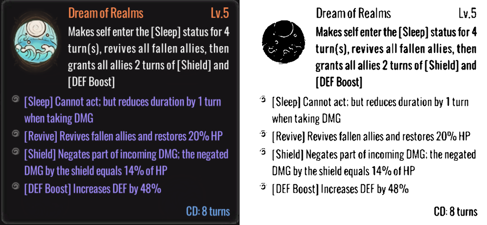

# Otimizei meu OCR até 100% de acerto. Numa imagem só.

*Estudo de caso do [RealTime Screen Translator](https://github.com/Daniel-S-Carneiro/RealTime-Screen-Translator)*
*Daniel S. Carneiro · rascunho de novembro de 2026*

> **Resumo.** Durante um mês, rodei milhares de combinações de filtros de imagem e
> parâmetros de OCR para deixar meu tradutor de jogos mais preciso e mais rápido.
> Usei força bruta, busca binária, quartis e até um modelo de linguagem (BERT) para
> corrigir o texto. Cheguei a 100% de acerto. Quando testei num print real de jogo,
> o pipeline "campeão" perdeu para a imagem sem tratamento nenhum, que foi mais
> precisa e três vezes mais rápida. Este texto conta o que fiz, onde errei e o que mudou.

---

## 1. O projeto

O RealTime Screen Translator é um tradutor de tela para jogos. Uma janela
transparente fica por cima do jogo. Ao clicar em **Traduzir Área**, o programa:

1. tira um print da região embaixo da janela;
2. trata a imagem;
3. lê o texto com OCR (reconhecimento óptico de caracteres);
4. limpa o texto lido;
5. traduz e mostra o resultado na própria janela.

**Tecnologias:** Python, PySide6 (interface), mss (captura de tela), OpenCV e
Pillow (imagem), EasyOCR rodando na GPU (OCR) e deep-translator (Google Tradutor).
Todos os testes rodaram num notebook com uma GeForce MX350.

A etapa difícil é o OCR. Texto de jogo é o pior caso: fontes estilizadas, cores
fortes, fundos com textura, letras pequenas e números que não podem sair errados
(dano, HP, porcentagens).

## 2. A pergunta

> Qual tratamento de imagem e qual configuração do EasyOCR dão o **maior acerto**
> no **menor tempo**?

## 3. Como medi

- **Imagem de teste:** `teste.png`, um texto de missão de 615 caracteres em fonte
  monoespaçada, letras claras sobre fundo escuro (1249×363 px).
- **Gabarito:** `teste.txt`, com o texto exato da imagem.
- **Métrica:** similaridade de Levenshtein entre o texto lido e o gabarito, em
  minúsculas. 100% significa texto idêntico.
- **Pipeline de imagem** em 5 etapas, cada uma com versão OpenCV e versão Pillow:

| Etapa | O que faz |
|---|---|
| Aumentar | Amplia a imagem em 2x |
| Ruído inicial | Filtro de mediana para tirar pontos soltos |
| Cor | Fica só com um canal (o verde) |
| Binarizar | Deixa tudo preto ou branco (Otsu ou limiar adaptativo) |
| Ruído final | Abertura morfológica para limpar o que sobrou |

Também tomei cuidados de medição que valeram a pena: uma rodada de aquecimento
antes de cronometrar (a primeira chamada na GPU é sempre mais lenta), média de
várias execuções e tempo medido etapa por etapa.

## 4. Os experimentos

Entre 13 de julho e 9 de agosto de 2026, escrevi 18 scripts de laboratório.

### 4.1 Força bruta

Se a ordem das etapas importa, e cada etapa pode usar OpenCV ou Pillow, existem
**5! ordens × 2⁵ bibliotecas = 3.840 combinações**. Rodei todas.

Somando a força bruta e o ajuste fino de parâmetros que veio depois, os relatórios
registram quase **10 mil combinações**.

O achado mais sólido dessa fase: **binarizar com Otsu é muito melhor que limiar
adaptativo**. Na média, Otsu acertou 97,9%, contra 58,3% e 52,0% dos dois métodos
adaptativos.

### 4.2 Gastando menos execuções: busca binária e separatrizes

Força bruta custa caro, então passei a buscar os parâmetros de forma mais esperta.

**Busca binária no `beamWidth`.** O decoder *beam search* do EasyOCR testa várias
hipóteses de leitura ao mesmo tempo. Quanto mais hipóteses, mais lento. Defini uma
meta de acerto (99,59%) e procurei o **menor** `beamWidth` entre 1 e 10 que
ainda batesse a meta:

```python
while limite_inferior <= limite_superior:
    meio = (limite_inferior + limite_superior) // 2
    acerto = medir(beamWidth=meio)
    if acerto >= META:
        melhor = meio                 # passou: tenta um valor menor
        limite_superior = meio - 1
    else:
        limite_inferior = meio + 1    # caiu: precisa de mais hipóteses
```

Em vez de 10 testes, foram 3 (larguras 5, 2 e 3). O resultado foi `beamWidth = 3`.

**Separatrizes (quartis) no contraste.** Para o `adjust_contrast`, testei primeiro
os quartis 0,25, 0,50 e 0,75 para achar a região promissora. Depois fiz uma busca
por bisseção no `contrast_ths`.

### 4.3 Ajudando o OCR com regex e IA

O OCR erra pontuação e letras soltas, então criei uma camada de pós-processamento:

- **Regex:** cola pontuação solta (`"HP ."` vira `"HP."`), remove resíduos
  (`"DMGI"` vira `"DMG"`) e insere o ponto final que o OCR "comeu" entre uma palavra
  minúscula e uma maiúscula (`"shadows If"` vira `"shadows. If"`).
- **SpellChecker + BERT:** o corretor ortográfico acha as palavras desconhecidas.
  O BERT, um modelo de linguagem, sugere a palavra que faz sentido naquele contexto,
  e fico com a sugestão mais parecida com o erro.

Num texto com erros reais de OCR (`"Good uck"`, `"recovery ."`), a correção
chegou a **100%**.

### 4.4 Onde o tempo realmente vai

Cronometrando cada etapa do pipeline campeão:

| Etapa | Tempo | % do total |
|---|---|---|
| 5 filtros de imagem, somados | 0,018 s | 0,14% |
| **OCR (EasyOCR, beam search)** | **12,67 s** | **95,89%** |
| Regex + SpellChecker | 0,001 s | 0,00% |
| BERT | 0,52 s | 3,96% |

E comparando decoders, todos com 100% de acerto em `teste.png`:

| Decoder | Tempo do OCR |
|---|---|
| **Greedy** | **6,74 s** |
| Beam search, largura 3 | 8,91 s |
| Beam search, largura 5 | 10,60 s |
| Beam search, largura 10 | 13,12 s |

### 4.5 E a tradução?

Comparei a tradução do Google com uma tradução de referência usando similaridade
semântica (o modelo MiniLM, que mede se duas frases dizem a mesma coisa). O resultado
foi **97,8%**. A similaridade letra por letra dava só 93%, porque traduções
corretas podem usar palavras diferentes. Conclusão: o tradutor não era o gargalo
de qualidade.

## 5. A virada: o primeiro print real

Alguns sinais já estavam nos relatórios, e eu não tinha dado atenção a eles.

**Sinal 1: empate demais.** No ajuste fino, **160 pipelines diferentes empataram
com o mesmo texto, caractere por caractere**. A partir daí, escolher o "campeão"
entre eles era sorteio: o teste já não conseguia diferenciar uma opção da outra.

**Sinal 2: metade dos dados era erro.** O passo `Binarizar` do Pillow devolve uma
imagem no modo `"1"` (booleana), que quebra as funções do OpenCV seguintes.
**1.920 das 3.840 linhas** da força bruta eram `ERRO`. Na prática, o Pillow nunca
foi avaliado.

**Sinal 3: otimizei a parte que quase não pesa.** Semanas foram para a ordem dos
filtros, que somam 0,14% do tempo. Testei três tipos de interpolação no aumento,
mas a escala ficou sempre em 2x, e isso deixa a imagem com 4x mais pixels para o
OCR processar.

Então peguei um print real de um jogo, uma descrição de habilidade com texto laranja,
branco e roxo sobre um fundo escuro com textura, e rodei o pipeline que estava em
produção:



*À esquerda, o print original. À direita, o resultado do pipeline campeão.*

Para nós, a imagem da direita parece mais limpa. Para o OCR, não:

| Configuração | Acerto | Tempo do OCR |
|---|---|---|
| Pipeline campeão dos labs (o de produção na época) | 97,1% | 3,7 s |
| **Imagem sem tratamento, decoder greedy** | **99,8%** | **1,1 s** |

O pipeline campeão leu `"14% of HP"` como **`"74% of HP"`**. Em outra imagem, o
aumento combinado com a limpeza morfológica juntou o "rn" de "turn" e produziu
**"tum"**. Os marcadores de lista (as espirais) viraram caracteres `5` soltos no
meio do texto.

O pós-processamento também piorou o texto real:

| Entrada | Saída |
|---|---|
| Press Enter to continue | Press**.** Enter to continue |
| New Game Load Game | New**.** Game Load**.** Game |
| Find Aerith near the Sector 5 Church | Find**. Earth** near the Sector 5 Church |
| Talk to Geralt in Novigrad | Talk to **Gerald** in Novigrad |
| Lv.5 | **La**.5 |

A regra do ponto final nasceu de `"shadows If"`, uma frase do meu texto de teste.
Em menus de jogo, porém, palavras com inicial maiúscula lado a lado são a regra. E o
BERT trata nomes de personagens como erros de digitação.

Por fim, a produção nem usava o que os labs tinham descoberto. Rodava beam search
com `beamWidth=1`, abaixo do mínimo de 3 que a minha própria busca binária havia
encontrado. Com largura 1, o decoder **engole letras duplas**: saíram "spoted",
"imediately", "God luck" e "falen alies". O BERT disfarçava parte disso no
`teste.png`, ao custo de mais de 1 segundo por tradução.

### O diagnóstico: *overfitting*

Em aprendizado de máquina, *overfitting* acontece quando um modelo decora os dados
de treino e falha em dados novos. Foi exatamente o que fiz, só que à mão. Eu tinha
**uma imagem**, e ela servia ao mesmo tempo de treino e de prova. Cada filtro, cada
parâmetro e cada regra de regex foram ajustados para ela. O resultado ficou perfeito
ali e pior em todo o resto.

As técnicas de busca não tinham culpa: busca binária e quartis funcionam quando há
uma curva a percorrer. Só que, com uma imagem só, a curva era praticamente plana,
quase tudo entre 99,6% e 100%. As buscas ficaram mais baratas, mas não havia nada
para encontrar. **O problema não era como eu procurava, era onde eu procurava.**

## 6. A correção de rumo

**Organização.** Os 18 scripts de laboratório e os relatórios foram arquivados. No lugar deles
entrou um único [benchmark](../benchmark/README.md), que **importa o código de
produção** em vez de copiá-lo. O app e o benchmark chamam a mesma função
(`pipeline_ocr.reconhecer_texto`), então o que é medido é exatamente o que roda.

**Métrica nova.** Troquei a similaridade pela **CER** (taxa de erro de caracteres:
quantas letras precisariam ser corrigidas, dividido pelo tamanho do texto) e pela
**WER** (o mesmo, contando palavras). Ambas são calculadas por imagem, para eu ver
onde o pipeline erra, e não só a média.

**Dataset real.** O próprio app ganhou um modo de coleta: cada captura é salva junto
com o texto lido, que serve de rascunho para o gabarito. Corrijo o rascunho olhando
a imagem e o par entra no benchmark.

**Mudanças na produção:**

| Antes | Depois | Por quê |
|---|---|---|
| Beam search, largura 1 | Greedy | Mais rápido e não engole letras duplas |
| Imagem binarizada e ampliada 2x | Só tons de cinza | Menos erro e de 2 a 4x mais rápido nas imagens do benchmark |
| Caixas de texto na ordem do EasyOCR | Ordenadas por linha | Trechos inclinados iam parar no fim do texto |
| Regex agressivo + BERT sempre ligados | Desligados por padrão, opcionais | Pioravam texto real e nomes próprios |
| BERT carregado ao abrir o app | Carregado só se for usado, e só em inglês | Abertura mais rápida; o modelo só conhece inglês |
| OCR na thread da interface | OCR e tradução em segundo plano | A janela congelava de 3 a 5 s a cada tradução |

**Primeiro resultado do benchmark** (3 imagens; CER menor é melhor):

| Configuração | Erro médio (CER) | Tempo médio |
|---|---|---|
| **Produção nova** (cinza + greedy) | **0,78%** | **2,9 s** |
| Imagem colorida sem tratamento | 0,97% | 2,9 s |
| Pipeline binarizado dos labs | 1,41% | 7,0 s |
| Regex agressivo + BERT | 0,89% | 3,6 s |

Três imagens ainda é pouco. O próximo passo é chegar a 15–30 prints de jogos
variados.

## 7. Resultados no dataset real

> **[A COMPLETAR]** Depois de juntar os prints: número de imagens e de jogos,
> tabela de CER/WER por configuração, a imagem em que cada uma errou mais e se
> algum padrão da produção mudou por causa disso.

## 8. O que aprendi

1. **Uma imagem de teste é um exemplo, não um dataset.** *Overfitting* não é
   exclusividade de quem treina modelos: qualquer ajuste feito olhando sempre para os
   mesmos dados pode decorá-los.
2. **Empate demais é um alarme.** Quando 160 configurações dão o mesmo resultado, o
   teste parou de medir o que importa.
3. **Meça antes de otimizar.** O perfil de tempo mostrava que o OCR era 96% do custo,
   e mesmo assim passei semanas nos filtros, que eram 0,14%.
4. **Busca esperta não conserta pergunta errada.** Busca binária e separatrizes
   economizaram execuções. O que faltava era variedade nos dados.
5. **Laboratório tem que importar a produção.** Quando o teste copia o código,
   os dois se separam sem ninguém perceber: a produção acabou rodando uma configuração
   que nenhum laboratório tinha testado.
6. **"Mais limpa para o olho" não é "mais fácil para o modelo".** A imagem binarizada
   parecia perfeita e trocou um 1 por um 7.
7. **Confira os erros silenciosos.** Metade da força bruta virou `ERRO` dentro do CSV,
   e só percebi muito depois.

## Como reproduzir

O benchmark e as instruções para montar o dataset estão em
[`benchmark/README.md`](../benchmark/README.md). Na pasta do projeto:

```
env\Scripts\python.exe benchmark\benchmark.py --detalhes
```
